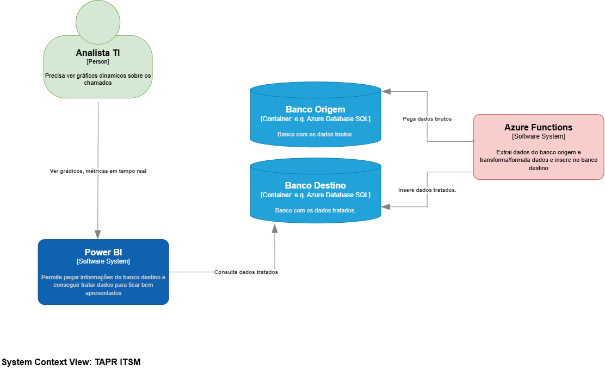
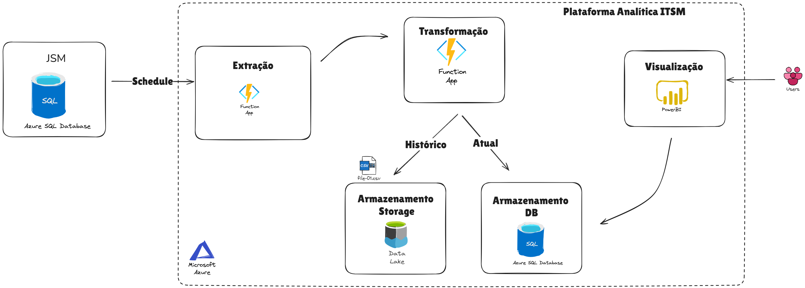
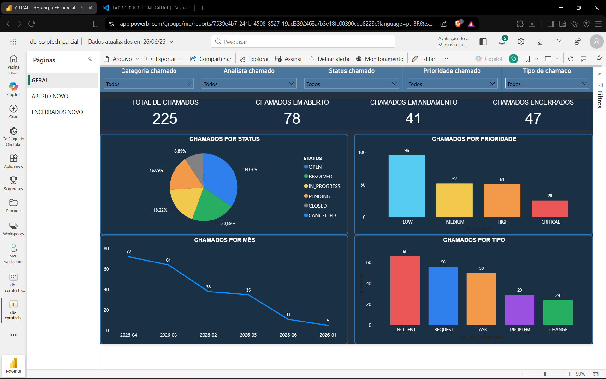
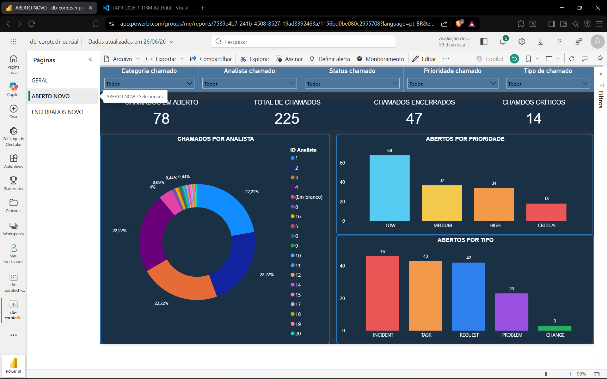
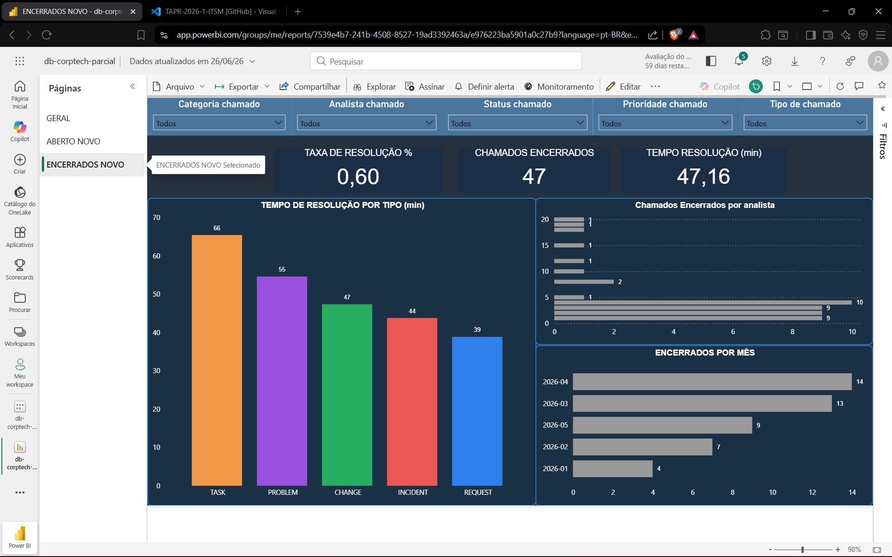

# TAPR-2026-1-ITSM

IT Service Management

# Integrantes

> Gian Carlo Fiamoncini, Edson Luis Rosa Junior, Gustavo Pereira e Carlos
> Alberto Junior

---

# Padrão de projeto: Strategy

**Strategy permite trocar a forma de executar uma tarefa sem alterar quem
coordena essa tarefa.** Neste projeto, podemos escolher como ler e gravar os
dados usados pelas 11 Azure Functions.

O fluxo é: **trigger → escolha das estratégias → leitura → gravação**.

| Arquivo | O que faz |
| --- | --- |
| [function_app.py](src/function_app.py) | Declara as 11 triggers e seus horários |
| [bootstrap.py](src/etl/bootstrap.py) | Escolhe as estratégias pela configuração |
| [strategies.py](src/etl/strategies.py) | Implementa as formas de ler e gravar |
| [extraction.py](src/etl/extraction.py) | Coordena a execução e controla as conexões e a transação |
| [queries/](src/etl/queries/) | Guarda os SQLs de cada entidade |

O `ExtractionRunner` recebe os objetos de leitura e gravação. Isso é
**composição**: ele usa outras classes para realizar partes do trabalho.
Para adicionar outra estratégia, implemente `read(cursor, sql)` ou
`write(cursor, sql, rows)` e registre sua fábrica no `bootstrap.py`.
O executor continua o mesmo.

## Configuração

Defina as opções na Function App ou em `Values` do `src/local.settings.json`:

| Variável | Opções | Padrão |
| --- | --- | --- |
| `ETL_READ_STRATEGY` | `fetch_all`: lê tudo; `fetch_many`: lê em lotes | `fetch_all` |
| `ETL_WRITE_STRATEGY` | `batch`: grava em lote; `row`: grava por linha | `batch` |
| `ETL_BATCH_SIZE` | Quantidade positiva de registros por lote em `fetch_many` | `1000` |

Por exemplo, `fetch_many` + `batch` + tamanho `500` lê até 500 registros por
vez e grava cada lote. Sem configuração, lê todos os registros e grava em lote.

As conexões usam `SQL_SERVER_SOURCE`, `SQL_DATABASE_SOURCE`, `SQL_USER_SOURCE`
e `SQL_PASSWORD_SOURCE`, além das equivalentes com sufixo `TARGET`.
A execução requer ODBC Driver 18 for SQL Server e o ambiente Azure configurado.

## Cuidados

O executor confirma a transação ao final (**commit**) e tenta desfazer a carga
se houver falha antes da confirmação (**rollback**). Ler em lotes reduz o uso
de memória, mas a transação continua abrangendo toda a carga. Os horários das
triggers não garantem a ordem entre entidades dependentes.

A integração com SQL Server e o host Azure ainda precisa ser validada.
A decisão de arquitetura está no [ADR-006](docs/adr006-strategy.md).

---

# Atividade de Documentação Arquitetural

### ADR's

- [adrr001-cloud](./docs/adr001-cloud.md)
- [adrr002-database](./docs/adr002-database.md)
- [adr003-azure-function](./docs/adr003-azure-function.md)
- [adr004-power-bi](./docs/adr004-power-bi.md)
- [adr005-template-method (substituído)](./docs/adr005-template-method.md)
- [adr006-strategy](./docs/adr006-strategy.md)

### C4 Diagram

- [Diagram DRAWIO](./docs/c4-contexto.drawio)

#### C4 Imagem

- 

---

# Escopo

# Print AZURE

# Justificativa Documento

[Link Documento](docs/antique/Justificativa_ITSM_Azure.docx)

# Dashboard Power BI

Para documentar o dashboard Power BI, seguem três prints:

## Geral

## Abertos

## Encerrados

